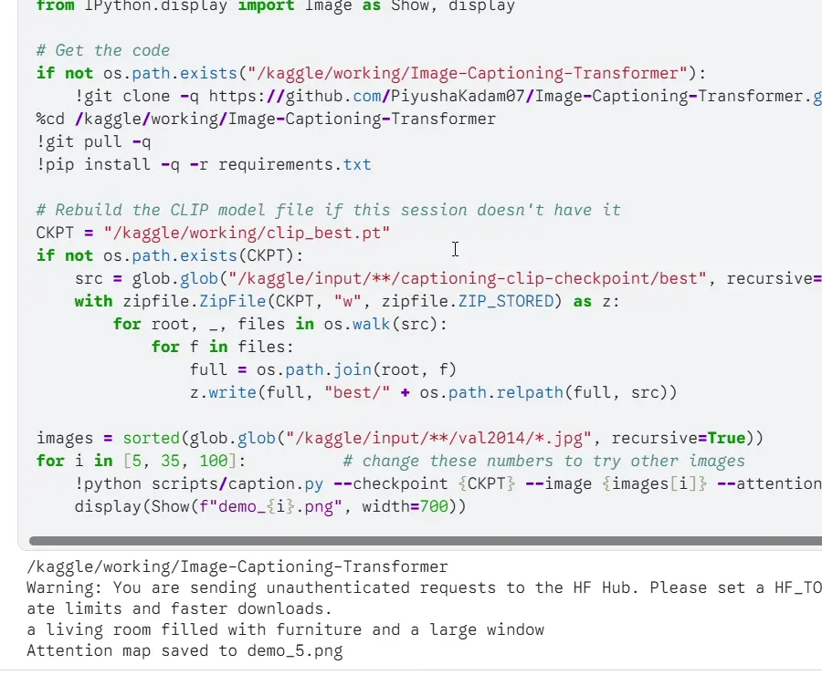
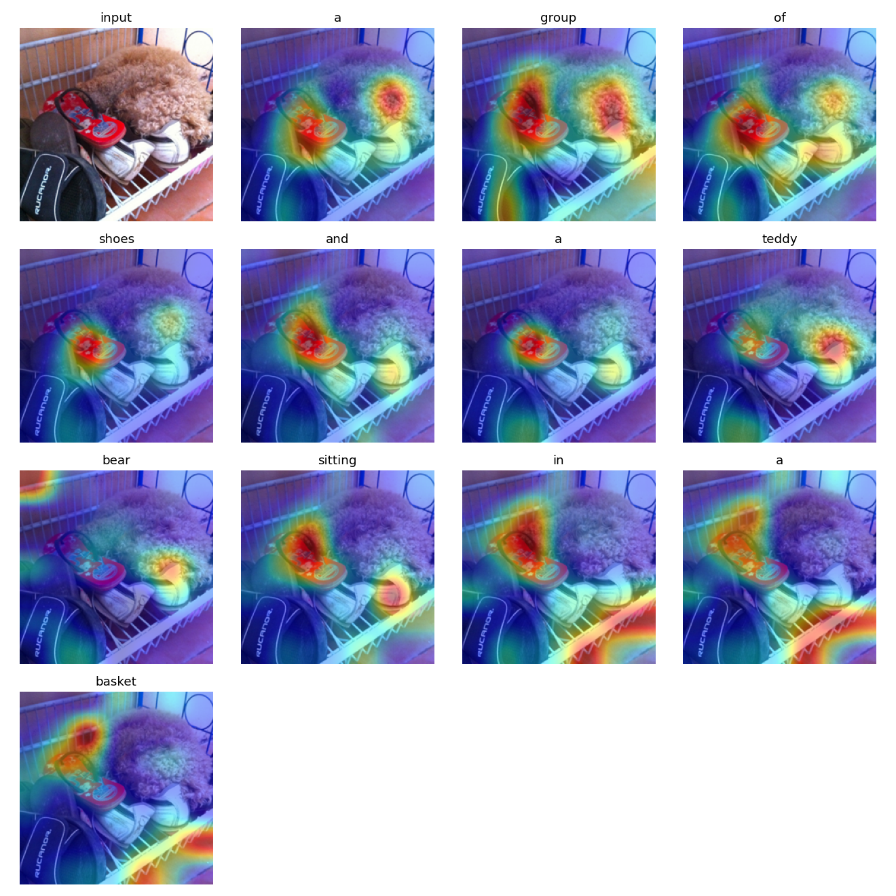
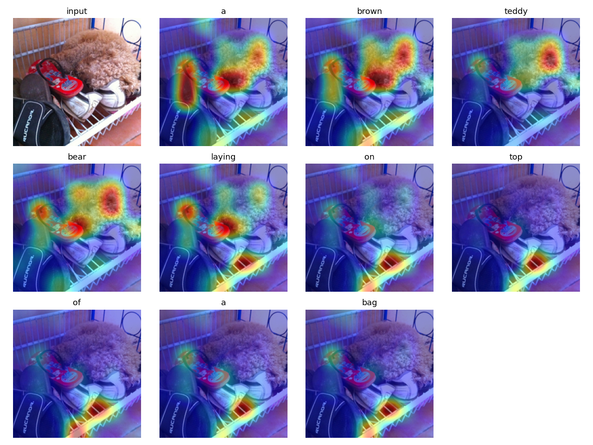
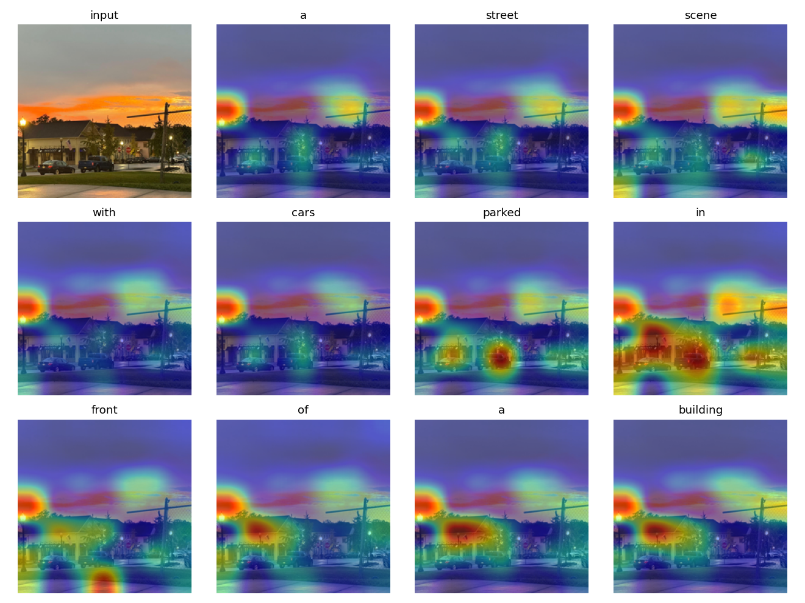

# Image Captioning: ResNet-50 vs CLIP with GPT-2



*The CLIP model captioning MS COCO test images: "a living room filled with furniture and a large window", "a baseball player holding a bat on top of a field", "a woman holding up a smart phone in front of her face". Each panel shows where the model was looking when it wrote that word.*

This project writes a short description for any photo. A pretrained image encoder (ResNet-50 or CLIP ViT-B/32) turns the image into a grid of region features, and a GPT-2 decoder writes the caption one word at a time, using cross-attention to look back at those regions. Because of that, you can see which part of the image the model was looking at for every word.

It started as our Kent State University course project, *Image Captioning Using Transformer* (see [Credits](#credits)). I rebuilt it from scratch to make it more solid and easier to compare: the original ResNet-50 + GPT-2 model is kept as a baseline, and I added a CLIP encoder, a standard 5,000-image test split, the official COCO evaluation, a better training setup and a demo.

The main result: with the same GPT-2 decoder and the same training setup, swapping ResNet-50 for CLIP raised CIDEr from 1.028 to 1.117 (+8.7%) and BLEU-4 from 0.309 to 0.333 on 5,000 held-out MS COCO test images.

## What changed from the original project

| | Original project | This version |
|---|---|---|
| Image encoder | ResNet-50 | ResNet-50 or CLIP ViT-B/32, chosen in the config |
| Data split | Our own 80/20 split | The Karpathy split (113K train / 5K val / 5K test) that published results use. If you don't have the Karpathy file, the same kind of split can be built from the official caption files |
| Encoder training | Frozen | Frozen at first, then the last block(s) fine-tuned at a lower learning rate |
| Training setup | AdamW, scheduler, gradient clipping | Also a cosine schedule with warmup, label smoothing and mixed precision |
| Picking the best model | Training loss | Validation CIDEr |
| Decoding | Beam search | Beam search with a length penalty and n-gram blocking, which stops repeats like "a vase of flowers … a vase of flowers" |
| Attention maps | Computed but not shown in the report | Shown word by word on top of the image |
| Demo | None | A Gradio app you can run locally |
| Tests | None | Unit tests and an end-to-end training test |

## How it works

```
image ──► encoder (ResNet-50: 7×7 grid  |  CLIP: 7×7 patch grid) ──► 49 region features
                                                                          │
                                         Linear + LayerNorm projection ◄──┘
                                                                          │
caption so far ──► GPT-2 (self-attention + cross-attention to regions) ──► next word
```

1. The encoder turns a 224×224 image into a 7×7 grid of region features.
2. A learned projection maps those features into GPT-2's 768-dimensional space.
3. While predicting each next word, GPT-2's cross-attention layers look over the 49 regions. Training uses teacher forcing and cross-entropy.
4. At inference time, beam search builds the caption, and the cross-attention weights become the heatmaps you see above.

## Results

These are scores on 5,000 held-out MS COCO 2014 test images, computed with the official COCO caption toolkit. The 5,000 validation and 5,000 test images were drawn from `val2014` with a fixed seed, following the Karpathy recipe. `python scripts/results_table.py <eval folder>` rebuilds this table from the evaluation outputs.

| Encoder | Decoding | BLEU-1 | BLEU-4 | METEOR | ROUGE-L | CIDEr |
|---|---|---|---|---|---|---|
| ResNet-50 | greedy | 0.725 | 0.302 | 0.259 | 0.536 | 0.993 |
| ResNet-50 | beam 3 | 0.710 | 0.309 | 0.269 | 0.540 | 1.028 |
| CLIP ViT-B/32 | greedy | **0.749** | 0.327 | 0.274 | 0.555 | 1.091 |
| CLIP ViT-B/32 | beam 3 | 0.734 | **0.333** | **0.283** | **0.560** | **1.117** |

Each model trained for 15 epochs on a free Kaggle GPU, which took about 3 to 4 hours. The encoder stayed frozen for the first 4 epochs, then its last block(s) were fine-tuned at a lower learning rate. I kept the checkpoint with the best validation CIDEr, measured on 1,000 images with greedy decoding:

- ResNet-50 went from 0.85 after epoch 1 to 1.00 after epoch 5, right after fine-tuning started, and peaked at 1.05.
- CLIP peaked at 1.145 around epoch 10 and stayed about level through epoch 15.

CLIP beats ResNet-50 on every metric (CIDEr +0.089, BLEU-4 +0.024, METEOR +0.014, ROUGE-L +0.020). The image encoder is the only thing that changed between the two runs, so the gain comes from CLIP's image features, which were pretrained to match images with text.

Beam search helps both models too. It raises CIDEr (ResNet-50 +0.035, CLIP +0.026), BLEU-4, METEOR and ROUGE-L, at a small cost in BLEU-1, because it tends to produce slightly shorter, more precise captions.

### Where the model looks for each word

Here's the same MS COCO image captioned by both models. Each panel shows the regions the decoder paid attention to while writing that word.

ResNet-50: *"a group of shoes and a teddy bear sitting in a basket"*



"Shoes" looks at the shoes, "teddy" at the fluffy toy and "basket" at the wire basket. For words that are easy to guess, like "bear" right after "teddy", the attention wanders off to a corner. That's common in attention models: when the next word is obvious, the model doesn't need to look anywhere in particular.

CLIP: *"a brown teddy bear laying on top of a bag"*



CLIP is more specific about the main object ("brown teddy bear"), but this time ResNet-50 gets the scene more right: the toy is in a basket, not on a bag. CLIP's attention is also more spread out. "Teddy" and "bear" land on the fur, but the later words drift to the edge of the basket. CLIP's patch features mix in information from the whole image, so its attention is less tied to single objects than ResNet-50's grid. So a better average score doesn't mean a better caption for every image, or easier-to-read attention.

### A photo from outside the dataset

To see how it handles something new, I captioned one of my own photos, a street at sunset that isn't in MS COCO, with the CLIP model and `scripts/caption.py`. It wrote *"a street scene with cars parked in front of a building"*.



That's a fair description. "Parked" looks at the cars in the lot, "in" spreads over the cars and the building, and "of a building" moves over to the building on the left. The street lamp on the left stays bright in almost every panel, since very bright spots tend to pull this model's attention no matter the word. And like the COCO captions it learned from, it talks about the objects and the place and leaves out the sunset.

### A note on the original project's numbers

The original report listed BLEU-4 0.31, METEOR 0.27 and ROUGE-L 0.54, which are close to this rebuild, but a CIDEr of 0.395. Models at this BLEU-4 level usually score around 1.0 CIDEr, so that figure was most likely computed on a different scale or setup. I wouldn't compare the two CIDEr numbers directly.

## Project structure

```
captioner/
  config.py      default settings, merged with a YAML config
  model.py       ResNet-50 / CLIP encoders, projection, GPT-2 decoder with cross-attention
  data.py        datasets, image transforms, caption tokenization, batching
  decoding.py    greedy and beam search with n-gram blocking; attention extraction
  metrics.py     BLEU, METEOR, ROUGE-L, CIDEr (official COCO caption toolkit)
  utils.py       tokenizer, checkpoints, attention heatmaps
scripts/
  prepare_data.py   Karpathy split → train/val/test JSONL
  train.py          training loop; keeps the best checkpoint by validation CIDEr
  evaluate.py       scores a checkpoint on the test split
  caption.py        captions one image and saves an attention figure
  results_table.py  builds the results table from evaluation outputs
configs/            resnet50.yaml (baseline), clip.yaml (CLIP version)
notebooks/          train_on_kaggle.ipynb, a ready-to-run notebook for Kaggle's free GPU
app.py              Gradio demo
tests/              unit tests and an end-to-end train → evaluate → caption test
```

## Getting started

### 1. Install
```bash
git clone https://github.com/PiyushaKadam07/Image-Captioning-Transformer.git
cd Image-Captioning-Transformer
pip install -r requirements.txt
```
METEOR and the official COCO tokenizer need Java. The other metrics work without it.

### 2. Get the data
- The MS COCO 2014 images (`train2014/` and `val2014/`) from [cocodataset.org](https://cocodataset.org/#download)
- The Karpathy split file `dataset_coco.json` if you have it, or the official `captions_train2014.json` and `captions_val2014.json`

```bash
python scripts/prepare_data.py --karpathy path/to/dataset_coco.json --out data
# or, without the Karpathy file (same recipe: 5K val + 5K test from val2014, fixed seed):
python scripts/prepare_data.py --coco-train captions_train2014.json --coco-val captions_val2014.json --out data
ln -s /path/to/coco2014 data/images      # the folder containing train2014/ and val2014/
```

### 3. Train
Full training needs a GPU. The easiest free option is the Kaggle notebook in `notebooks/train_on_kaggle.ipynb`.
```bash
python scripts/train.py --config configs/resnet50.yaml                      # baseline
python scripts/train.py --config configs/clip.yaml                          # CLIP version
python scripts/train.py --config configs/clip.yaml --subset 5000 --epochs 1  # quick check
```
Each epoch uses one random caption per image (COCO has five), so the model still sees every caption over the course of training for a fifth of the compute. Set `train.all_captions: true` to use all five every epoch.

### 4. Evaluate
```bash
python scripts/evaluate.py --checkpoint runs/clip/best.pt                 # beam search
python scripts/evaluate.py --checkpoint runs/clip/best.pt --beam-size 1   # greedy
python scripts/results_table.py runs
```

### 5. Caption your own image
```bash
python scripts/caption.py --checkpoint runs/clip/best.pt --image photo.jpg --attention attention.png
CHECKPOINT=runs/clip/best.pt python app.py      # web demo
```
A single image runs fine on a CPU.

## Tests
```bash
pytest tests
```
The tests use a tiny, randomly initialized model and a byte-level tokenizer, so they run offline on a CPU. The end-to-end test trains on plain red and blue images, checks that the model learns to caption them correctly, and then runs the evaluation and captioning scripts. It takes a few minutes.

## Limitations
- It can only describe the kinds of things MS COCO covers, mostly everyday objects and scenes, and only in English. Charts, screenshots, logos or famous landmarks get described as the closest everyday thing it knows.
- COCO captions carry cultural and gender biases, and a model trained on them can repeat those.
- Training uses cross-entropy only. Optimizing CIDEr directly with self-critical sequence training (Rennie et al. 2017) would be the next thing to try.

## Credits
The original course project at Kent State University was built by:
- **Piyusha Kadam**: MS COCO data pipeline (preprocessing, augmentation, image-caption alignment), GPT-2 tokenization and padding, ResNet-50 feature extractor integration, literature review
- **Varun Nagarkar**: training loop, hyperparameter tuning, evaluation scripts, attention visualization
- **Suwei Gao**: GPT-2 cross-attention decoder, decoding strategies, ablation studies

I (Piyusha Kadam) built this rebuilt version.

Built with [PyTorch](https://pytorch.org/), [Hugging Face Transformers](https://huggingface.co/docs/transformers) (GPT-2, CLIP), [torchvision](https://pytorch.org/vision/) (ResNet-50) and [pycocoevalcap](https://github.com/salaniz/pycocoevalcap). Dataset: [MS COCO](https://cocodataset.org/).

## License
MIT
